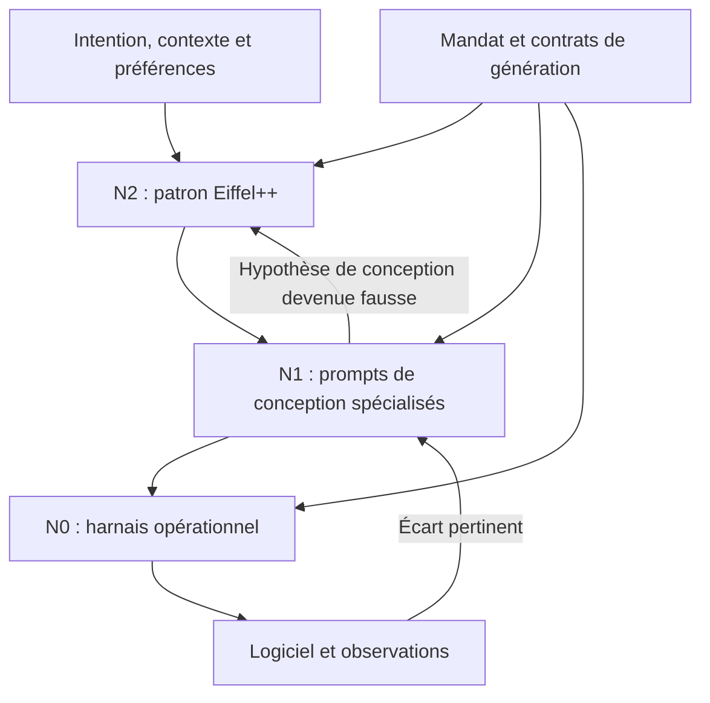

# Eiffel++

**Un patron de harnais qui génère la méthode de travail adaptée à un projet.**

Version du patron, du catalogue et du protocole : **0.2.0**.

Eiffel++ commence avant le développement du logiciel. À l'étape zéro, un agent interprète le projet, ses impératifs et les préférences de ses responsables, produit un **méta-harnais spécialisé**, puis utilise celui-ci pour générer le **harnais opérationnel**. La méthode de production devient elle-même un livrable du projet.

Le générateur peut inventer une organisation adaptée, combiner des mécanismes existants, en simplifier ou en écarter. Il ne se limite pas à choisir un profil dans une liste de recettes.

## Les trois niveaux

| Niveau | Objet | Entrées | Sortie |
| --- | --- | --- | --- |
| **N2 — patron Eiffel++** | Prompts génériques de conception et contrats de génération. | Intention, contexte, ressources, impératifs, préférences et mandat. | **N1**, des prompts spécialisés capables de concevoir et réviser la méthode du projet. |
| **N1 — méta-harnais du projet** | Règles de synthèse, de qualification et d'adaptation de la méthode. | Profil, besoins disponibles, capacités des outils et, plus tard, observations. | **N0**, des instructions opérationnelles et les mécanismes nécessaires pour les faire respecter. |
| **N0 — harnais du projet** | Instructions concrètes pour gouvernance, STBL, audit et production. | Besoins acceptés, mandats, contrats et état courant du logiciel. | Logiciel, éléments probants, questions et décisions à instruire. |

Le logiciel est le produit de N0 ; il n'est pas un quatrième niveau de harnais. Les quatre dépôts sont les responsabilités de N0, pas quatre niveaux d'abstraction.



Chaque retour est borné et motivé. Aucun niveau ne s'accorde lui-même de nouveaux droits. Une modification du harnais n'impose pas de régénérer tous les documents ni de recommencer tout le projet.

## Le tétraèdre du projet

Le profil décrit quatre préférences : **rapidité**, **économie**, **fonctionnalités utiles** et **autonomie des agents**. Le quatrième axe exprime la volonté de réduire la charge de supervision humaine dans le mandat accordé.

Les poids `speed`, `economy`, `scope` et `autonomy` sont positifs ou nuls et leur somme vaut 1. Ils situent les préférences dans un tétraèdre ; ils ne représentent ni des performances mesurées ni une loi selon laquelle améliorer un axe dégrade nécessairement les autres.

Le profil précise aussi les obligations non compensables, les mesures, les inconnues et le budget de génération. Une permission ne découle jamais du poids donné à l'autonomie. Les exigences de sûreté, de sécurité ou de validité métier restent des contraintes lorsqu'elles ont été déclarées obligatoires.

Voir le [modèle d'arbitrage](meta/TETRAHEDRON.md) et le [contrat de génération](meta/CONTRACT.md).

## Commencer par l'étape zéro

**Point d'entrée à donner à un agent : [meta/START.md](meta/START.md).** Joindre un brief et les impératifs déjà connus. L'agent ne demande que les précisions qui peuvent réellement changer la méthode ; il conserve les autres inconnues et peut travailler sous hypothèses autorisées.

Le [guide des prompts](meta/README.md) décrit la production de N1 puis de N0. Les contrats et budgets limitent la recherche ; un prototype réversible n'impose pas une campagne de benchmarks avant de commencer.

Pour préparer un paquet autonome depuis la racine du dépôt :

```bash
python3 tools/meta_harness.py prepare --brief examples/meta/dashboard-local/brief.md --profile examples/meta/dashboard-local/profile.json --output ../etape-zero
```

Cette commande prépare les entrées et les prompts. **La synthèse de N1 et N0 est effectuée par un LLM dans l'environnement choisi**, pas par un algorithme caché dans le script Python. Les outils locaux n'appellent aucun service de modèle.

Après génération, vérifier les deux sorties puis matérialiser les quatre dépôts :

```bash
python3 tools/meta_harness.py check examples/meta/dashboard-local/meta-harness
python3 tools/meta_harness.py check examples/meta/dashboard-local/harness
python3 tools/meta_harness.py materialize examples/meta/dashboard-local/harness --meta-harness examples/meta/dashboard-local/meta-harness --output ../dashboard-local --git-init
```

Les chemins ci-dessus utilisent un **exemple fictif fourni**, pas un projet client déjà validé. Voir le [démarrage détaillé](docs/QUICKSTART.md).

## Quatre responsabilités, une organisation générée

| Dépôt produit | Responsabilité conservée | Ce que N1 adapte |
| --- | --- | --- |
| `<projet>-governance` | Mandats, méthode et versions applicables. | Flux de travail, budgets, autonomie, contexte, mémoire, conditions d'adaptation. |
| `<projet>-stbl` | Besoins logiciels, questions et décisions. | Granularité des besoins, questions utiles, contrats métier et organisation de leur évolution. |
| `<projet>-audit` | Examen de la qualité, des défauts, de la sécurité et de l'adéquation au besoin. | Contrôles proportionnés, oracles, indépendance requise et retour des contre-exemples. |
| `<projet>-product` | Conception et réalisation dans le mandat. | Organisation des tâches, outils, agents éventuels, intégration et vérifications techniques. |

Quatre responsabilités n'impliquent ni quatre agents actifs à chaque tâche ni quatre conversations supplémentaires. Les décisions et métadonnées déterministes peuvent être traitées par des programmes ordinaires.

Les [quatre patrons de responsabilité](patterns/01-governance.md) et les fichiers `templates/` deviennent une **bibliothèque de composants de conception**. Le générateur y prend ce qui sert au projet et produit de nouveaux fichiers lorsque nécessaire. Aucun agent n'est tenu de charger toute la bibliothèque.

## Ce que la version fournit

- Un patron N2 et des prompts réutilisables pour produire N1, générer N0, les examiner et les faire évoluer.
- Un modèle de préférences à quatre axes, distinct des obligations et des observations.
- Des schémas JSON pour les profils et les deux niveaux de sortie.
- Deux [chaînes complètes illustratives](examples/meta/README.md), avec briefs, profils, prompts N1 et harnais N0 différents.
- Un outil de préparation, de vérification structurelle et de matérialisation des sorties générées.
- Les quatre patrons de responsabilité, le protocole commun et les composants de la version précédente.
- Des contrôles du catalogue et des outils, avec un [compte rendu d'exécution](docs/VALIDATION.md).

## Développement par contrat à chaque niveau

N2 doit produire un générateur adapté et explicable. N1 doit produire un harnais compatible avec le besoin, le mandat et les ressources. N0 doit produire le logiciel et les éléments probants requis.

Une chaîne de références relie chaque règle du harnais à une raison : obligation, préférence, hypothèse ou observation. Le producteur ne peut pas modifier seul les besoins ou les oracles pour faciliter l'acceptation. Une génération réussie au sens structurel ne vaut pas adoption de sa méthode, mesure de ses performances ou validation du logiciel.

Les états `PROPOSED`, `NOT_RUN`, `UNKNOWN` et `STALE` gardent leur sens. Une délégation existante peut autoriser des adaptations automatiques ; elle ne doit pas être redemandée à chaque modification réversible. Voir [le protocole](protocol/README.md), [le modèle de confiance](protocol/TRUST.md) et [le déploiement](docs/DEPLOYMENT.md).

## Réutiliser l'instanciation générique

L'outil historique reste disponible pour copier la bibliothèque générique dans quatre dépôts. Il n'effectue pas la synthèse contextuelle N2 → N1 → N0 :

```bash
python3 tools/instantiate.py --project mon-projet --name "Mon projet" --output ../mon-projet --git-init
```

Les deux modes créent de nouveaux dossiers sans écraser l'existant. Ils ne publient pas de dépôt distant, ne configurent pas les droits d'un compte et laissent les références Git à résoudre en `UNBOUND`.

## Vérifier et contribuer

```bash
python3 tools/check_catalog.py
python3 -m unittest discover -s tests -v
```

Ces vérifications portent sur la cohérence du catalogue et les outils locaux. Eiffel++ 0.2.0 ne fournit pas un service hébergé d'orchestration, un prouveur universel ou une garantie d'optimalité. L'efficacité du harnais généré dépend du contexte et reste à observer. Les exemples sont des démonstrations de conception, sans benchmark de logiciel métier exécuté.

Le projet est indépendant, sans affiliation ni approbation de Bertrand Meyer. Le nom rend hommage au développement par contrat ; il ne désigne pas une nouvelle version du langage Eiffel. Licence MIT. Voir [les contributions](CONTRIBUTING.md), [les références](docs/REFERENCES.md) et [les changements](CHANGELOG.md).
