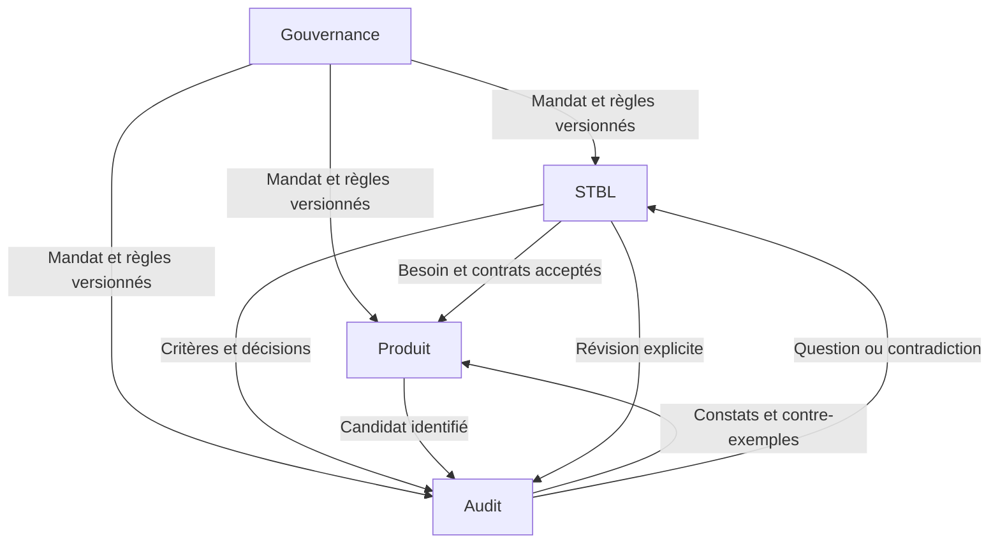

# Eiffel++

**Quatre métapatrons de harnais pour produire du logiciel avec des agents IA, sous contrats vérifiables.**

Version du catalogue et du protocole : **0.1.0**.

Eiffel++ sépare quatre responsabilités : décider comment travailler, établir ce qui est demandé, examiner ce qui a été produit, puis construire le logiciel. Ce dépôt est le **catalogue public des modèles**. Chaque projet l'instancie en **quatre dépôts Git distincts**, avec des historiques, droits et mandats propres.

Le nom rend hommage à l'approche de Bertrand Meyer. Ce projet indépendant n'est ni une nouvelle version du langage Eiffel, ni un produit officiel, ni une méthode approuvée par Bertrand Meyer. Il ne dépend d'aucun fournisseur d'IA ou langage de programmation.

## Les quatre métapatrons

| Dépôt d'un projet | Métapatron | Question dont il est responsable | Point d'entrée |
| --- | --- | --- | --- |
| `<projet>-governance` | **Le cadre révisable** | Qui peut faire quoi, avec quels outils, budgets et règles ? | [Patron](patterns/01-governance.md) · [Template](templates/01-governance/README.md) |
| `<projet>-stbl` | **Besoin explicite et décisions traçables** | Quel service est attendu, quelles questions restent ouvertes, qui a décidé ? | [Patron](patterns/02-stbl.md) · [Template](templates/02-stbl/README.md) |
| `<projet>-audit` | **Cabinet d'audit indépendant** | Que pouvons-nous établir sur la conformité, les défauts, la sécurité et la qualité ? | [Patron](patterns/03-audit.md) · [Template](templates/03-audit/README.md) |
| `<projet>-product` | **Le producteur sous contrat** | Comment réaliser le comportement accepté et corriger les contre-exemples ? | [Patron](patterns/04-product.md) · [Template](templates/04-product/README.md) |

STBL signifie ici **spécifications techniques des besoins logiciels**. Elles expriment les résultats attendus, contraintes et critères d'acceptation ; elles ne doivent pas imposer par défaut tous les détails de l'implémentation.

## Démarrer

Prérequis : Python 3.10 ou plus récent ; Git seulement pour l'option `--git-init`. Aucune dépendance Python externe.

```bash
python3 tools/check_catalog.py
python3 -m unittest discover -s tests -v
python3 tools/instantiate.py --project mon-projet --name "Mon projet" --output ../mon-projet --git-init
```

L'outil produit quatre dossiers autonomes contenant chacun ses fichiers Markdown, un instantané identifié du protocole commun et, avec `--git-init`, son propre dépôt Git. Il n'écrase aucun dossier existant, ne crée aucun dépôt distant et n'accorde aucun droit. Les références aux dépôts restent `UNBOUND` tant que des versions réelles n'ont pas été établies.

Suivre ensuite le [guide de démarrage](docs/QUICKSTART.md), remplir les STBL et le mandat, puis configurer les protections réelles décrites dans [DEPLOYMENT.md](docs/DEPLOYMENT.md).

## Ce que contient cette version

- Quatre patrons décrivant problème, forces, responsabilités, contrats, heuristiques, coopération et limites.
- Quatre jeux de fichiers Markdown prêts à adapter, dont des `AGENTS.md` courts et des formulaires réutilisables.
- Un [protocole commun](protocol/README.md) : identifiants, messages, états, références immuables, invalidation et acceptation.
- Un [exemple d'inscription à un atelier](examples/booking/README.md), avec un besoin, une question métier, un contrat et des contre-exemples illustratifs.
- Un outil d'instanciation et des contrôles structurels du catalogue.
- Un [compte rendu de validation du catalogue](docs/VALIDATION.md), distinct d'un audit des projets futurs.
- Des [sources primaires](docs/REFERENCES.md) distinguées des choix propres à Eiffel++.

Les mots **DOIT**, **NE DOIT PAS** et **PEUT** définissent les règles du modèle. Ce sont des exigences à mettre en œuvre, pas l'affirmation qu'un mécanisme d'accès ou de vérification a déjà été installé.

## La règle structurante

**Le producteur peut transformer l'implémentation dans son mandat ; il ne peut pas modifier seul les critères d'acceptation ni produire lui-même l'attestation indépendante qui permet la livraison.**

Une décision métier vient du Product Owner ou d'une délégation enregistrée. Un résultat de contrôle vient de son exécution réelle. Un avis d'agent peut orienter l'enquête ; il n'est pas une preuve mécanique. Un contrôle inconclusif ne devient jamais silencieusement une réussite.



## Ce que la séparation en quatre dépôts apporte

Elle rend les changements de méthode, de besoin, de verdict et de code distincts et traçables. Elle facilite les droits séparés et les examens indépendants. Elle crée aussi un coût de synchronisation : Eiffel++ le traite par des références exactes aux quatre dépôts et des échanges courts.

La séparation n'est pas une garantie suffisante. Si une seule identité peut réécrire les quatre historiques et les contrôles, l'indépendance reste documentaire. Le [modèle de confiance](protocol/TRUST.md) précise les protections à réaliser.

Quatre dépôts ne sont pas un dogme universel : pour une expérience très courte, ils peuvent coûter plus qu'ils n'apportent. Ce catalogue choisit cette structure pour les projets où la séparation des responsabilités et leur réutilisation sont utiles.

## Limites explicites

Eiffel++ **0.1.0 est un catalogue de harnais et un protocole**, pas un moteur autonome complet. Il ne lance pas lui-même de modèles, d'audits de sécurité ou de preuves. Les contrôles fournis portent sur la cohérence structurelle des modèles et sur l'instanciation ; ils ne certifient pas les logiciels futurs.

La validité d'un besoin reste à confronter au métier et aux usages. Une preuve porte sur les propriétés, hypothèses et outils annoncés. Les critères d'audit doivent rester contestables par une procédure distincte.

## Contribuer et réutiliser

Voir [CONTRIBUTING.md](CONTRIBUTING.md), [SECURITY.md](SECURITY.md) et le [journal des changements](CHANGELOG.md). Le catalogue, les templates et les outils sont distribués sous [licence MIT](LICENSE). Les projets générés choisissent leur propre licence pour leur code métier.
