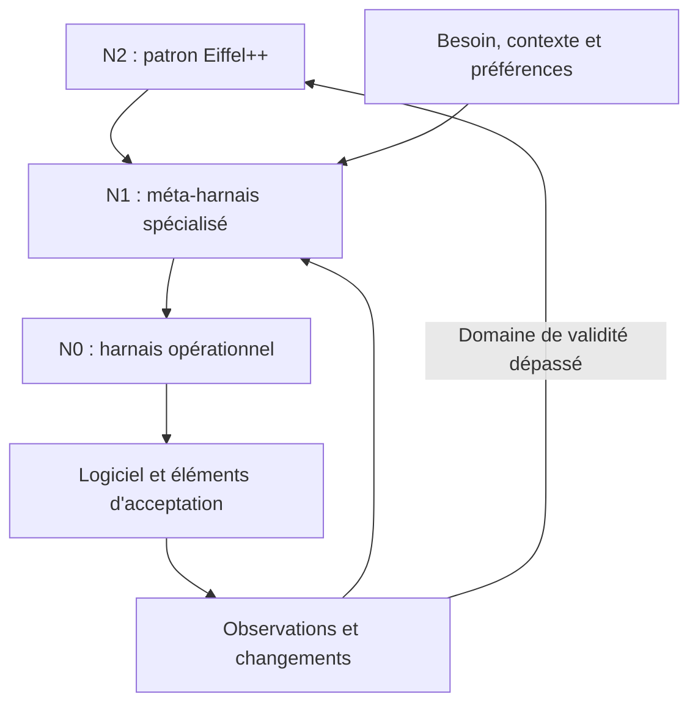

# Eiffel++ : patron génératif à trois niveaux

Eiffel++ définit comment engendrer une méthode de travail adaptée. Le résultat attendu de l'étape zéro est le harnais du projet, accompagné du générateur qui pourra le faire évoluer.

| Niveau | Objet | Ce qu'il produit |
| --- | --- | --- |
| **N2 — patron Eiffel++** | Instructions de génération, contrat de génération et modèle des arbitrages. | **N1**, un méta-harnais composé de prompts spécialisés pour le contexte du projet. |
| **N1 — méta-harnais du projet** | Une manière de comprendre le contexte, d'engendrer une méthode, de la qualifier et de la réviser. | **N0**, le harnais opérationnel adapté aux besoins et aux impératifs courants. |
| **N0 — harnais opérationnel** | Instructions, procédures et contrôles répartis entre gouvernance, STBL, audit et produit. | Le logiciel et les éléments permettant son acceptation. |

Le logiciel constitue le résultat de N0, hors de ces trois niveaux. Un rôle peut être rempli par une personne, un agent ou un programme ; quatre responsabilités n'imposent pas quatre agents.



## Entrée unique

Donner [START.md](START.md) à un agent avec le brief, les sources disponibles et les préférences connues. Il conduit N2 → N1 → N0 dans un budget borné. Il peut travailler avec des informations incomplètes, en conservant ses hypothèses et en isolant les questions réellement décisives.

Un moteur d'agent quelconque peut interpréter ces prompts. Leur présence ne lance pas un modèle et n'installe pas des permissions. Les outils du catalogue préparent, vérifient structurellement et matérialisent les fichiers ; le LLM réalise la synthèse.

```bash
python3 tools/meta_harness.py prepare --brief briefing.md --profile profile.json --output ../etape-zero
python3 tools/meta_harness.py check ../etape-zero/meta-harness
python3 tools/meta_harness.py check ../etape-zero/harness
python3 tools/meta_harness.py materialize ../etape-zero/harness --meta-harness ../etape-zero/meta-harness --output ../projet --git-init
```

Ces commandes s'exécutent depuis la racine du catalogue. `prepare` fournit un paquet d'entrée ; les dossiers `meta-harness` et `harness` sont ensuite écrits par l'agent. Aucun résultat N1 ou N0 n'est attribué à la seule exécution de `prepare`. `check` ne démontre ni l'adéquation métier ni l'efficacité du harnais. Une matérialisation ne vaut pas adoption.

## Les quatre prompts de N2

| Prompt | Transformation |
| --- | --- |
| [01-characterize.md](prompts/01-characterize.md) | Besoin et contexte → profil, obligations, hypothèses et questions utiles. |
| [02-generate-meta-harness.md](prompts/02-generate-meta-harness.md) | Profil → prompts N1 capables de synthétiser et d'adapter une méthode. |
| [03-qualify.md](prompts/03-qualify.md) | N1 ou N0 candidat → examen de cohérence, limites, corrections et conditions d'usage. |
| [04-adapt.md](prompts/04-adapt.md) | Changement ou observation → adaptation locale de N0, ou révision bornée de N1. |

Ces prompts décrivent des responsabilités de génération. Un agent peut enchaîner les transformations dans une seule séance. Une séparation supplémentaire n'est introduite que si l'indépendance, la confidentialité ou le coût la justifie.

## Produire un générateur, pas remplir un questionnaire

Le méta-harnais doit formuler des règles de synthèse propres au projet : quels indices chercher, comment comprendre une incertitude, quelles procédures engendrer, quand employer un contrôle mécanique, à quel moment demander une décision et comment adapter le contexte chargé.

Il peut inventer une organisation absente du catalogue. Les anciens patrons et les harnais externes constituent des composants possibles. Leur popularité ne constitue pas une obligation d'emploi.

Par exemple, la même préférence d'autonomie peut conduire à une livraison automatique d'un outil local réversible, ou à des agents autonomes pour préparer un dossier dont la livraison exige une décision humaine. La contrainte change la méthode ; le coefficient seul ne choisit pas un profil préfabriqué.

## Arbitrages et portée

Le [tétraèdre](TETRAHEDRON.md) représente les préférences entre rapidité, économie, fonctionnalités utiles et autonomie. Le [contrat de génération](CONTRACT.md) définit ce que chaque niveau doit conserver en transformant le suivant.

Les propriétés non négociables restent des contraintes. Les gains de coût ou de délai sont des hypothèses jusqu'à mesure. Le générateur peut fournir un premier harnais utilisable sans exiger une campagne comparative préalable ; il indique ce qui a été examiné, exécuté ou laissé à vérifier.

N1 est un artefact de gouvernance, conservé avec sa version lorsque N0 est matérialisé avec l'option `--meta-harness`. La matérialisation conserve aussi le patron N2 disponible dans le catalogue sous `governance/_eiffel/meta/`, afin qu'une révision ultérieure puisse retrouver son point d'entrée. Les métadonnées distinguent cette disponibilité d'une preuve que cette version exacte de N2 a produit le N1 fourni.

Ces archives ne créent pas un cinquième dépôt opérationnel et ne sont chargées que lorsque le niveau concerné est nécessaire. L'adaptation demeure soumise au mandat courant ; elle ne s'accorde pas elle-même de nouveaux droits.
